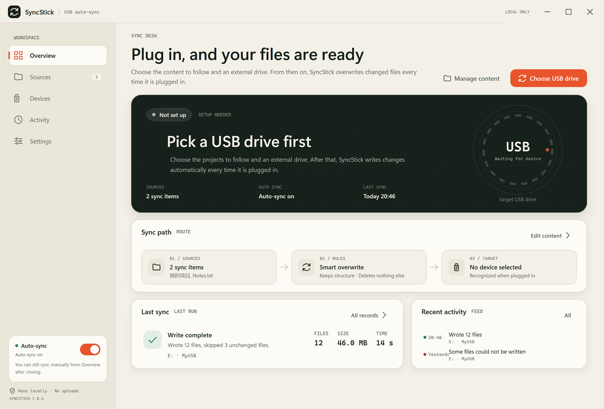
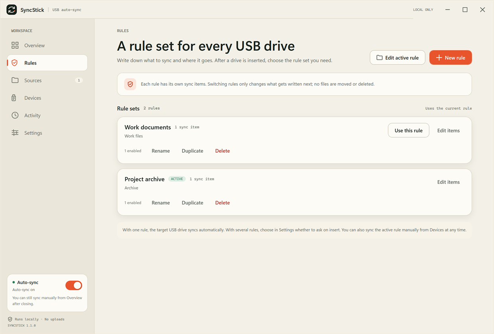
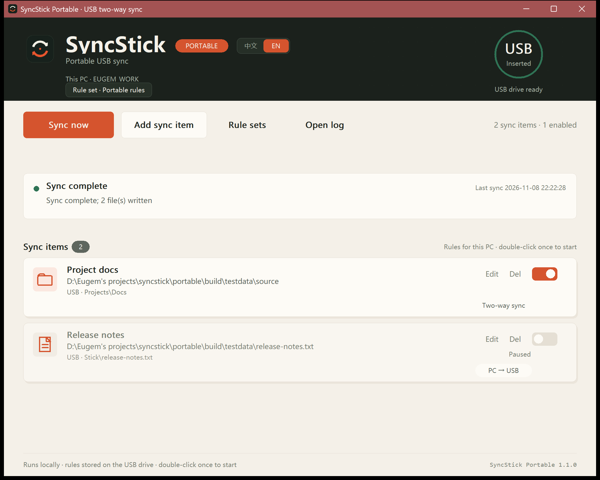

# SyncStick

Automatically write or overwrite selected files and folders on a specified USB drive when it is plugged in.

[中文](README.md) · English

The repository contains two editions:

| Edition | Best for | Implementation |
| --- | --- | --- |
| Desktop 1.1.0 | A normal PC, and a USB drive you want to keep clean | WPF / .NET 10, tray resident, syncs on insert |
| Portable 1.1.0 | Low-resource PCs, or PCs without the .NET runtime | Native C++ / Win32, one exe on the USB drive, one double-click |







## Features

### Desktop

- Remembers the target USB drive by volume serial number, so it still works after changing the drive letter or USB port.
- Add multiple files or folders; each item can have its own destination subfolder on the USB drive.
- Save sync layouts as named rule sets (for example Work and Archive). When a USB drive is inserted, choose the set to use; each drive remembers its last choice.
- “Smart overwrite” by default: only new or changed files are copied; skipped when size and modification time match.
- Optional “mirror clean”: removes extra files from the destination folder; off by default and confirmed before enabling.
- Writes to a temporary file and renames it atomically, so unplugging mid-write does not leave a half-written file.
- Clear errors for cancellation, unplugging, insufficient space, and missing sources.
- Keeps the last 60 activity records, runs in the tray, and can start with Windows.
- USB hard drives that Windows reports as fixed disks can be enabled under “Other drives”.
- Chinese and English UI; choose the language in Settings.

### Portable

- No installation, no registry writes; configuration and logs stay on the USB drive.
- Rules are identified per PC and stored on the same USB drive.
- Multiple named rule sets are supported; choose one at startup, and each PC remembers its last choice.
- Bidirectional sync: the newer modification time wins; differences under 3 seconds are treated as a conflict and skipped.
- Never deletes files.
- The USB destination supports a relative path and a folder picker.
- Pauses automatic sync when the desktop edition is running, to avoid two writers on one USB drive.
- Chinese and English UI; language can follow the system or be selected manually.

## Repository layout

```text
SyncStick/
├─ src/                 # Desktop C# projects
├─ tests/               # Desktop tests
├─ docs/                # Desktop documentation and screenshots
├─ tools/               # Desktop release packaging
├─ portable/            # Portable C++/Win32 project
│  ├─ src/
│  ├─ tests/
│  ├─ assets/
│  ├─ packaging/
│  ├─ build.ps1
│  └─ docs/screenshots/
├─ release/             # Verified release zips and checksums
├─ Directory.Build.props
├─ SyncStick.sln
├─ LICENSE
├─ README.md            # Chinese README
└─ README.en.md         # This file
```

## Build

### Desktop

Requirements: Windows 10/11 x64 and the .NET 10 SDK.

```powershell
dotnet build SyncStick.sln -c Release -m:1
dotnet run --project tests/SyncStick.Tests/SyncStick.Tests.csproj -c Release
dotnet run --project tests/SyncStick.CoordinatorTests/SyncStick.CoordinatorTests.csproj -c Release
```

Create the release package under `dist/`:

```powershell
powershell -NoProfile -ExecutionPolicy Bypass -File tools/build-release.ps1
```

The desktop release is framework-dependent. The target PC needs the [.NET 10 Desktop Runtime x64](https://dotnet.microsoft.com/download/dotnet/10.0).

### Portable

Requirements: MinGW-w64 (g++ and windres). The build script looks in `C:\mingw64\bin`; change `$mingw` at the top of `portable/build.ps1` if yours is elsewhere.

```powershell
powershell -NoProfile -ExecutionPolicy Bypass -File portable/build.ps1
```

The script compiles `core.cpp`, `main.cpp`, and the resource file, runs the core tests, and packages `SyncStickPortable.exe`, `autorun.inf`, help files, and the README into `portable/dist/`.

## Releases

`release/` contains verified archives:

- `SyncStick-1.1.0-win-x64.zip`: desktop edition; extract and run `SyncStick.exe`.
- `SyncStickPortable-1.1.0.zip`: portable edition; extract to the USB root and run `SyncStickPortable.exe`.
- `SHA256SUMS.txt`: SHA-256 checksums for both archives.

## Known limitations

- The desktop edition is one-way: changes made on the USB drive are not copied back to the PC.
- Desktop and portable rules are stored separately and are not merged automatically; when both are running, the portable edition pauses automatic sync.
- Smart overwrite compares size and modification time, not file content hashes. FAT32 timestamp precision is about 2 seconds.
- FAT32 cannot store a single file larger than 4 GB.
- Releases are not code-signed, so Windows SmartScreen may warn on first launch.
- Windows does not allow an EXE on a USB drive to autorun silently. The portable edition needs one double-click; `autorun.inf` only provides the icon and volume label.
- Startup registration can fail under restricted permissions, sandboxes, or security software; the desktop edition shows recovery instructions.
- Windows 11 may put new tray icons in the `^` overflow area.

## License

[MIT](LICENSE)
