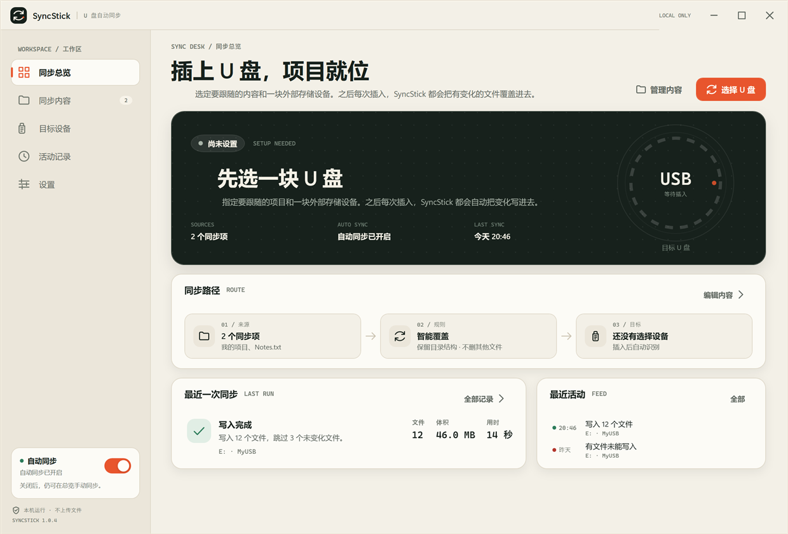
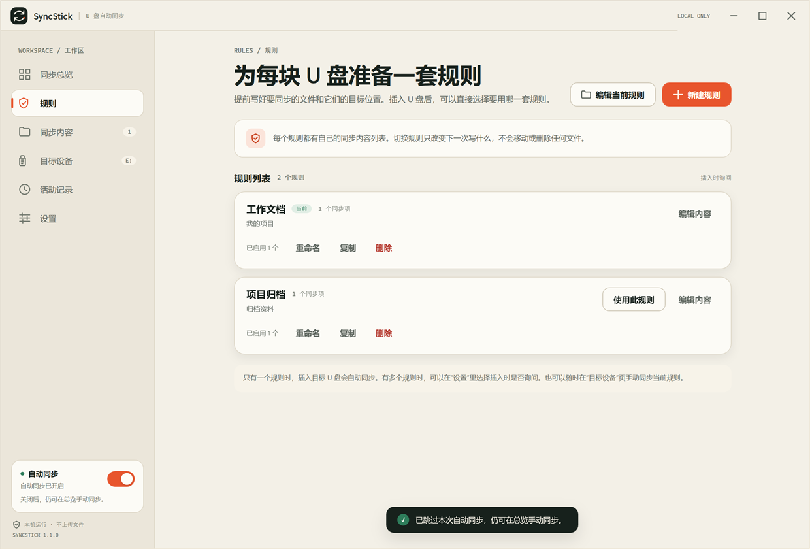
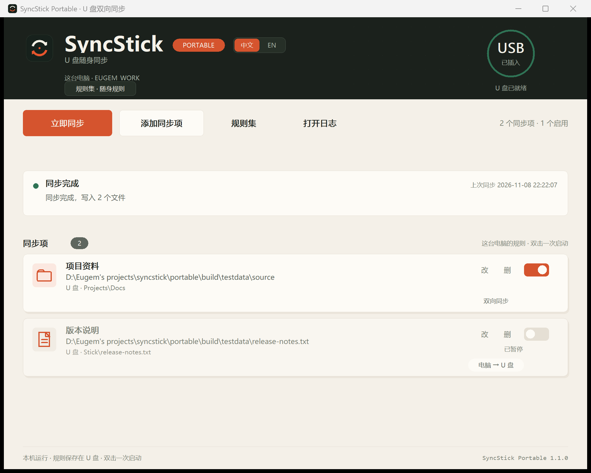

# SyncStick

把电脑上指定的文件或文件夹，在插入指定 U 盘时自动写入或覆盖。

[中文](README.md) · [English](README.en.md)

仓库包含两个版本：

| 版本 | 适用场景 | 实现 |
| --- | --- | --- |
| 桌面版 1.1.0 | 电脑配置正常，希望 U 盘保持干净 | WPF / .NET 10，常驻托盘，插入后自动同步 |
| 便携版 1.1.0 | 电脑配置较低，或不想安装 .NET 运行时 | 原生 C++ / Win32，单文件放在 U 盘里，双击一次运行 |

桌面版和便携版都支持中文 / English 界面；语言可在界面或程序目录的配置里选择。







## 功能

### 桌面版

- 按卷序列号记住目标 U 盘，换盘符、换 USB 口后仍能识别。
- 可以添加多个文件或文件夹，每个同步项单独设置 U 盘内的子目录。
- 可以把同步内容保存成多套命名“规则”，例如工作文档、项目归档；插入 U 盘时选择这次要用的规则，每块设备会记住上次的选择。
- 默认“智能覆盖”：只复制新增或修改过的文件，大小和修改时间都相同时跳过。
- 可选“镜像清理”：删除 U 盘目标目录中多余的文件；默认关闭，开启前二次确认。
- 先写临时文件再原子改名，避免中途拔出留下半个文件。
- 支持取消、拔盘、空间不足、来源缺失等错误提示。
- 最近 60 次活动记录，托盘后台运行，可设置开机启动。
- 固定磁盘型的 USB 硬盘可以在“其他驱动器”中选用。
- 中文 / English 界面，可在“设置”里切换；标题样式文字不含句号。

### 便携版

- 不安装、不写注册表，配置和日志都放在 U 盘里。
- 按当前电脑识别规则；每台电脑的规则保存在同一支 U 盘上。
- 支持多套命名规则集，启动时可选择这次使用哪一套；每台电脑会记住上次的选择。
- 双向同步，文件修改时间较新的一方覆盖较旧文件；3 秒内视为冲突，不覆盖。
- 不做删除操作，不会因为同步清空 U 盘。
- U 盘内目标位置支持相对路径，也可以直接浏览选择文件夹。
- 检测到桌面版正在运行时暂停自动同步，避免两个程序同时写同一支 U 盘。
- 中文 / English 界面，首次运行按系统语言选择，也可以手动切换。

## 目录结构

```text
SyncStick/
├─ src/                 # 桌面版 C# 项目
├─ tests/               # 桌面版测试
├─ docs/                # 桌面版说明和截图
├─ tools/               # 桌面版发布打包脚本
├─ portable/            # 便携版 C++/Win32 项目
│  ├─ src/
│  ├─ tests/
│  ├─ assets/
│  ├─ packaging/
│  ├─ build.ps1
│  └─ docs/screenshots/
├─ release/             # 已打包的发行版和校验值
├─ Directory.Build.props
├─ SyncStick.sln
├─ LICENSE
├─ README.md            # 中文说明
└─ README.en.md         # 英文说明
```

## 构建

### 桌面版

需要 Windows 10/11 x64 和 .NET 10 SDK。

```powershell
dotnet build SyncStick.sln -c Release -m:1
dotnet run --project tests/SyncStick.Tests/SyncStick.Tests.csproj -c Release
dotnet run --project tests/SyncStick.CoordinatorTests/SyncStick.CoordinatorTests.csproj -c Release
```

生成发布包，输出到 `dist/`：

```powershell
powershell -NoProfile -ExecutionPolicy Bypass -File tools/build-release.ps1
```

发布版是 framework-dependent 的，目标电脑需要安装 [.NET 10 Desktop Runtime x64](https://dotnet.microsoft.com/download/dotnet/10.0)。

### 便携版

需要 MinGW-w64（g++、windres）。默认脚本从 `C:\mingw64\bin` 查找工具链，如路径不同，修改 `portable/build.ps1` 开头的 `$mingw`。

```powershell
powershell -NoProfile -ExecutionPolicy Bypass -File portable/build.ps1
```

脚本会编译 `core.cpp`、`main.cpp` 和资源文件，运行核心测试，并把 `SyncStickPortable.exe`、`autorun.inf`、`说明.txt` 和 README 打包到 `portable/dist/`。

## 发行版

`release/` 中放着已验证的压缩包：

- `SyncStick-1.1.0-win-x64.zip`：桌面版，解压后运行 `SyncStick.exe`。
- `SyncStickPortable-1.1.0.zip`：便携版，解压到 U 盘根目录，双击 `SyncStickPortable.exe`。
- `SHA256SUMS.txt`：上面两个文件的 SHA-256。

## 已知限制

- 桌面版不做双向同步：U 盘上的修改不会回写到电脑。
- 桌面版和便携版规则分开保存，不会自动合并；同时运行时会提示并暂停便携版自动同步。
- 智能覆盖依赖文件大小和修改时间，不做文件内容哈希比较；FAT32 的时间精度约 2 秒。
- FAT32 U 盘无法存放超过 4 GB 的单个文件。
- 发布包没有代码签名，首次运行可能出现 Windows SmartScreen 提示。
- Windows 禁止 U 盘里的 EXE 静默自动运行；便携版需要双击一次，`autorun.inf` 只负责图标和卷标。
- 开机启动在受限权限、沙箱或安全软件拦截时可能失败，桌面版会给出重试说明。
- Windows 11 可能把新托盘图标收进任务栏右下角的 `^` 里。

## 许可证

[MIT](LICENSE)
