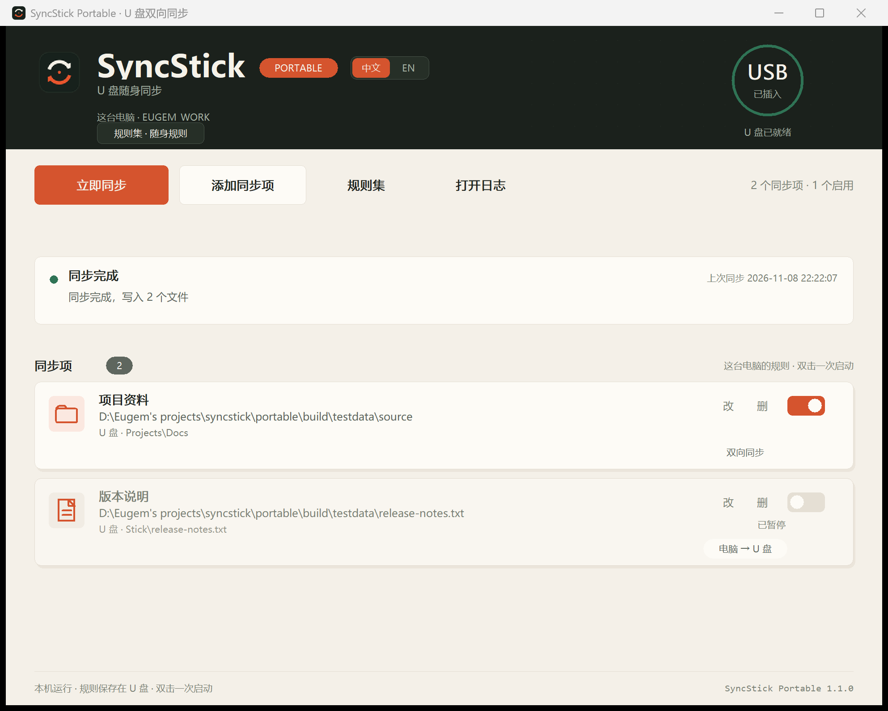
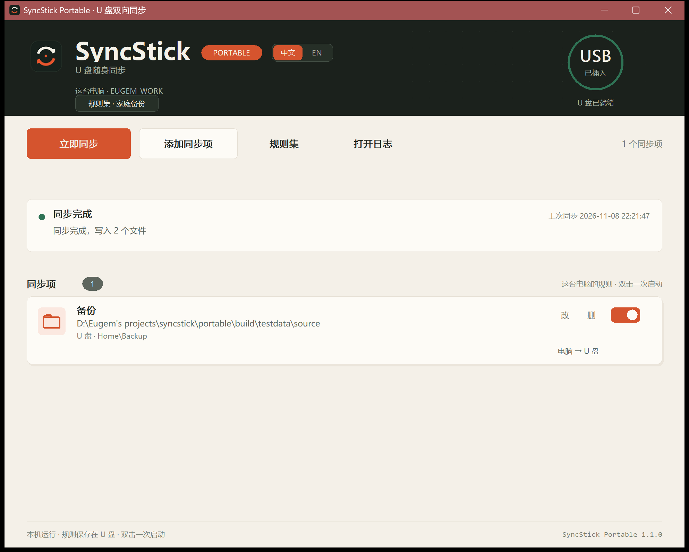
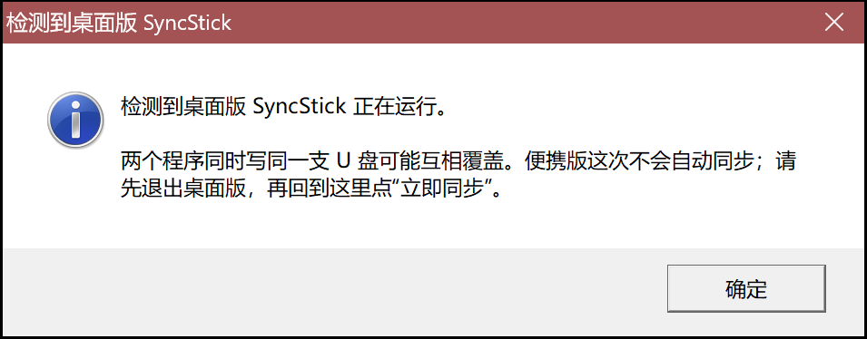
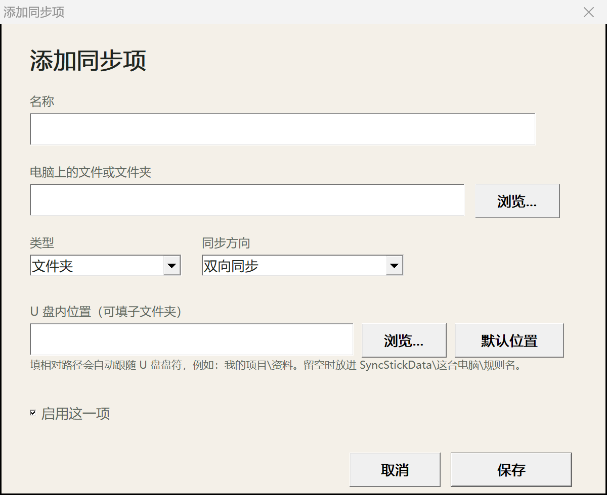

# SyncStick Portable

放在 U 盘里的双向同步小工具。插上 U 盘，双击一次，程序会自动识别当前电脑，把规则里指定的文件夹或文件在电脑与 U 盘之间同步。原生 C++/Win32，单文件 exe，不需要 .NET、不需要安装、不需要管理员权限。支持简体中文 / English 界面，首次运行跟随系统语言，也可以在右上角切换。





## 和桌面版的区别

| | 桌面版 SyncStick | 便携版 SyncStick Portable |
|---|---|---|
| 运行位置 | 装在本机，后台常驻 | 放在 U 盘，双击一次运行 |
| 自动触发 | 插入 U 盘时自动写入 | 受 Windows 限制，需双击一次 |
| 目标电脑 | 本机 | 任何插上这支 U 盘的 Windows 电脑 |
| 规则存储 | 本机 | U 盘里的 `SyncStickPortable.ini`，多套规则集共用；每台电脑记住上次选择 |
| 是否清空 U 盘 | 可开启镜像清理 | 不删除文件 |

Windows 10/11 禁止 U 盘里的 EXE 静默自启，`autorun.inf` 只能设置图标和卷标，不能绕过这条限制；真正“插入即写入”请用桌面版。

## 和桌面版同时存在时

两个程序同时写同一支 U 盘，可能互相覆盖，所以便携版会检查桌面版的单实例标记：

- 桌面版正在运行：便携版不自动同步，弹窗说明原因；桌面版退出后点“立即同步”即可。
- 桌面版没运行：便携版照常同步。



没有做“自动比较两边规则新旧、让新规则整体覆盖”的原因：两边的规则模型和文件范围不一定相同，整体覆盖容易误删或误改；先保证不打架更安全。若以后要做，建议另外定义“规则版本 + 只覆盖同一条规则”的明确语义。

## 已实现

- 每台电脑独立规则：用 `MachineGuid` 生成稳定电脑 ID，规则存在 U 盘里；换 USB 口、换盘符都不会丢。
- 多套命名规则集：顶部“规则集”按钮或 Ctrl+R 新建、重命名、删除、切换；启动时若有多套会先选择，每台电脑记住上次选择。
- 文件夹与单文件两种同步项。
- 双向同步（默认）、仅电脑 → U 盘、仅 U 盘 → 电脑。
- 双向模式下比较两边修改时间；较新一边覆盖较旧一边；两边 mtime 相差 3 秒内视为冲突并跳过，不冒险覆盖。
- 只复制/覆盖，不删除任何文件。
- 临时文件 + 原子替换，避免写一半的坏文件；保留修改时间；空间不足会提前报错。
- U 盘内位置默认自动生成，放在 `SyncStickData\<电脑名>\<规则名>`；也可以点“浏览…”直接选 U 盘里的文件夹，或手填相对路径（例如 `我的项目\资料`），相对路径会跟随盘符。添加同步项时可以直接看到这个设置：

  

- 启动后自动同步一次；可手动“立即同步”、F5、启用/停用单项规则、编辑、删除。
- 如果检测到桌面版 SyncStick 正在运行，便携版会暂停自动同步并提示先退出桌面版，避免两个程序同时写同一支 U 盘。
- 添加规则时才创建配置文件与日志（`SyncStickPortable.ini`、`SyncStickPortable.log`），不联网、不上传。
- 日志里记录每次同步的开始、复制方向、完成摘要和冲突。
- 中文 / English 界面：右上角一键切换，选择写入 `SyncStickPortable.ini` 的 `language=`；也可用 `--lang zh|en` 临时指定。

## 运行

目录结构：

```text
SyncStickPortable.exe
autorun.inf
说明.txt
README.md
SyncStickPortable.ini      ← 首次添加规则后生成
SyncStickPortable.log      ← 同步日志
SyncStickData\             ← 默认 U 盘同步目录
```

1. 把以上文件放在 U 盘根目录（或任意文件夹）。
2. 插上 U 盘，双击 `SyncStickPortable.exe`。
3. 给这台电脑“添加同步项”，选择电脑上的文件夹/文件，U 盘内位置可留空。
4. 以后插上这支 U 盘，双击一次即可自动识别电脑并同步。

## 构建与测试

依赖 MinGW-w64（已验证 `C:\mingw64` 的 g++ 16.1.0）：

```powershell
cd "D:\Eugem's projects\syncstick\portable"
.\build.ps1
```

脚本会编译 `src\core.cpp`、`src\main.cpp`，用 `windres` 嵌入图标/版本信息，跑 `tests\core_test.cpp`，产出 `dist\SyncStickPortable\` 和 `dist\SyncStickPortable.zip`。

手工构建：

```powershell
g++ -std=c++20 -municode -Wall -Wextra -Isrc -c src/core.cpp -o build/core.o
g++ -std=c++20 -municode -Wall -Wextra -Isrc -c src/main.cpp -o build/main.o
windres src/resources.rc -O coff -o build/resources.o
g++ -std=c++20 -municode build/main.o build/core.o build/resources.o `
  -o build/SyncStickPortable.exe -mwindows -static `
  -lcomctl32 -lole32 -luuid -lshell32 -lshlwapi -lgdi32 -luser32 -ladvapi32
```

测试覆盖：电脑 ID 稳定性、首次同步、第二次跳过、电脑更新、U 盘更新、只存在 U 盘文件、单向不删除、冲突、配置往返，共 29 项检查。

## 已知限制

- 无代码签名，首次运行可能出现 Windows SmartScreen 提示。
- 便携版不能绕过 Windows 的 U 盘静默自启限制；“自动”指的是双击启动后自动同步。
- 规则对话框使用经典 Win32 控件（未嵌入 comctl32 v6 manifest，MinGW 链接会与默认 manifest 冲突），视觉上比主界面朴素。
- 冲突策略是“较新修改时间获胜，3 秒内跳过”，不做三路合并。
- 当前版本只做用户可见文件的复制；不处理符号链接/权限 ACL。
